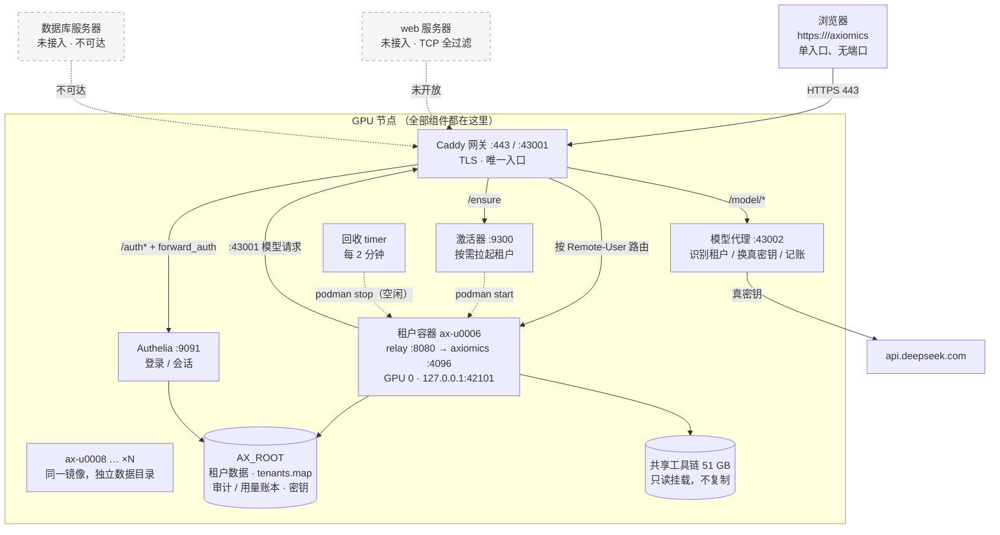
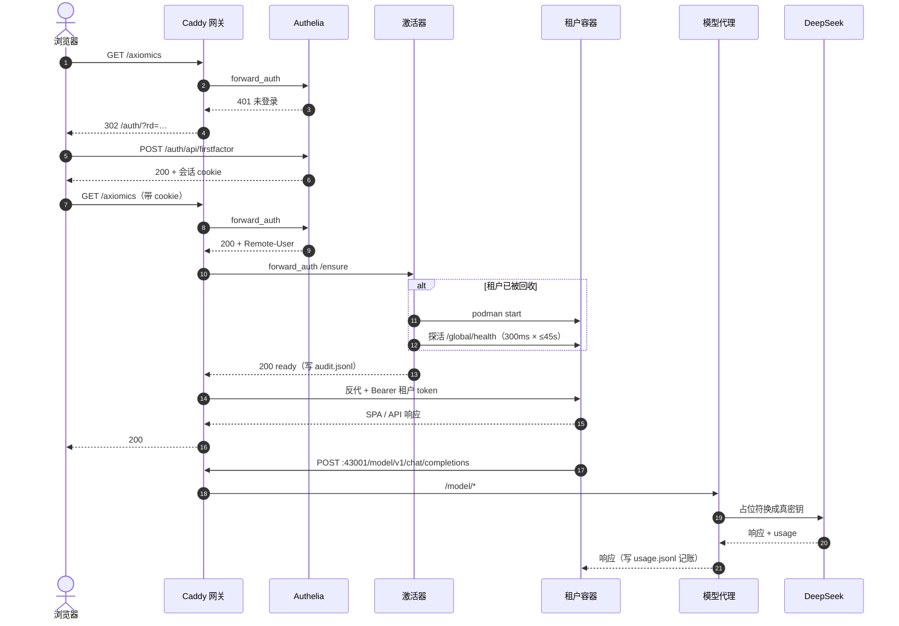

# 多租户架构总览

给"现在到底长什么样"一个单一入口。设计与论证见
[`多租户实施方案.md`](./多租户实施方案.md)，日常操作见
[`多租户运维手册.md`](./多租户运维手册.md)。

图的可编辑版本在 `docs/diagrams/`，由 `gen.py` 生成：

```bash
python3 docs/diagrams/gen.py     # 重新生成两张 .drawio
```

---

## 一、一句话

**目前是单机架构**：一台 GPU 服务器（`<GPU 节点>`）承载网关、鉴权、控制面、
全部租户容器和全部数据。另外两台服务器（web / db）**尚未接入**，也没有网络通路。

---

## 二、当前架构



**三条边界**

| 边界 | 内容 |
| --- | --- |
| 网络 | 只有 `443`（用户入口）和 `43001`（模型出口）绑在对外地址上；Authelia `9091`、激活器 `9300`、模型代理 `43002`、租户端口 `42xxx` 全部绑 `127.0.0.1` |
| 租户 | 一人一容器，独立 PID/net/fs 与数据目录；容器内 bwrap 沙箱 |
| 密钥 | 真实模型密钥只在 `secrets/deepseek.key`（0600），租户只见到 `tenant-uXXXX` 占位符 |

---

## 三、一次请求的路径



**每一步都有落点，排障时按链逐段核对**：登录 → `auth/db.sqlite3`；
激活 → `logs/audit.jsonl`；模型 → `logs/usage.jsonl`；
网关 → `logs/access.log`（含 `remote_ip`，客户端连不上时先看这里有没有它）。

---

## 四、三台服务器的现实

| 服务器 | 地址 | 从 GPU 节点看 | 结论 |
| --- | --- | --- | --- |
| GPU | `<GPU 节点>` | 本机 | 全部组件在此 |
| web | `<web 节点>` | **ping 通（0.67ms），TCP 22/80/443 全过滤** | 网络可达，被策略挡住 |
| db | `<db 节点>` | **ICMP 都不回** | 不在同一可达网段 |

**堡垒机不等于隧道。** 在 `<堡垒机>` 上开网页会话，不会改变上述三层可达性；
它只是让你从它能到的位置去操作目标机。所以跨机部署的前提是**中心开端口白名单**，
而不是"登录一下就好"。

### 两种形态

**A. 维持单机（当前）**
- 优点：已验证、无跨机依赖、控制面简单（激活器直接 `podman start` 本机容器）。
- 缺点：GPU 节点同时承担入口与计算；web/db 两台闲置。

**B. 拆成三层（需要网络与设计改动）**
- web 服务器放 Caddy + Authelia（对外入口）。
- GPU 服务器只放租户容器。
- 数据库服务器承载共享状态（Authelia 存储、审计/账本）。
- **代价**：激活器现在直接调本机 `podman`，拆开后必须换成跨机调用或每台自管；
  租户数据是否共享文件系统也要定。这不是配置项，是设计改动。

**建议**：先维持 A 把服务稳定交付；B 作为后续演进，等中心把
`<GPU 节点> → <web 节点>` 的 443/22 打通后再评估。

---

## 五、部署与运维入口

| 动作 | 命令 |
| --- | --- |
| 从零部署 | `AX_IDP_USER=alice AX_IDP_PASS='…' ./deploy.sh` |
| 生产补装单元（不中断网关） | `AX_KEEP_CONTAINERS=true ./deploy.sh` |
| 开机自恢复 | 4 个 systemd 用户单元 + `loginctl enable-linger` |
| 开通 / 注销 / 查看 | `bin/axiomics-tenant add\|retire\|list` |
| 用量 / 审计 | `bin/axiomics-usage` / `bin/axiomics-audit` |

租户容器**不设开机自启**：回收策略是"空闲即停"，重启后由激活器按需拉起（约 1 秒）。
